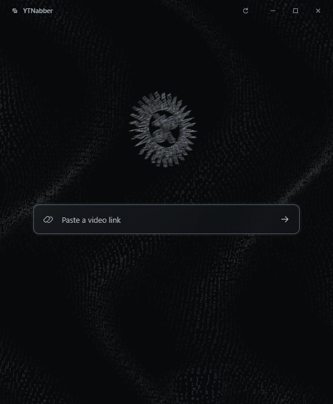

# ytnabber

A compact Windows desktop app for downloading a single video or saving its audio. Built with Tauri 2, Rust, TypeScript and Canvas 2D.

## Download

Get the **Windows x64 installer** from [GitHub Releases](https://github.com/Hakaelll/ytnabber/releases/latest). Installation is per user and does not require administrator rights.

Windows 10 or 11 and Microsoft Edge WebView2 are required. If WebView2 is missing, the installer downloads Microsoft's runtime. yt-dlp, Deno and FFmpeg are already included: no terminal, Python installation or manual PATH setup is needed.

The initial release is unsigned. Its SHA-256 checksum is published with the installer; verify that you downloaded it from this repository.

## Use

1. Paste a public video URL. Metadata loads automatically, or press Enter.
2. Select **MP4**, **MP3** or **M4A**.
3. For MP4, choose Best available or a resolution actually reported by the source.
4. Choose a destination if needed, then click **Download**.
5. Click **Open folder** after the file is saved.

The app remembers your last destination and otherwise uses your Windows Downloads folder. Downloads can be cancelled, including while FFmpeg is processing media. Existing files are never replaced; choose another destination or rename an existing file to download the same output again.

MP4 uses the source video and audio with remuxing when required. MP3 uses V0 variable bitrate; M4A prefers the original AAC stream and converts when necessary. Audio quality cannot exceed the original. Some direct media links do not expose a duration, thumbnail or resolution; those fields remain unavailable instead of showing invented values.

## Interface

- One compact window, no queue, account, history or settings screen.
- Monochrome Graphite surfaces with a restrained Liquid Glass treatment on controls.
- The supplied sun emblem reconstructed as a layered point sculpture, rotating to the right.
- An autonomous field of tiny characters: warped sheets, currents, empty regions and blue-gray wave deformation. It does not react to the mouse.
- A 25 FPS animation cap, bounded canvas resolution, pre-rendered glyphs and an adaptive character count.
- Animation stops while the document is hidden and respects Windows reduced-motion preferences. Reduced transparency and high-contrast modes receive solid control surfaces.

## Develop

Use Windows x64 with:

- Node.js 22.12+ or 24 LTS and npm.
- Stable Rust with the MSVC toolchain.
- Microsoft C++ Build Tools, including **Desktop development with C++**.
- Microsoft Edge WebView2.

See [Tauri's Windows prerequisites](https://v2.tauri.app/start/prerequisites/#windows) for the native build tools.

~~~powershell
npm ci
npm run engines:prepare
npm run desktop:dev
~~~

The engine preparation script downloads exact releases from upstream GitHub repositories and verifies their SHA-256 hashes against the committed manifest. Downloads are cached under .cache/engines. It uses Windows tar.exe to extract ZIP archives.

~~~powershell
npm run desktop:build
~~~

The installer is generated in:

~~~text
src-tauri/target/release/bundle/nsis/ytnabber_0.1.0_x64-setup.exe
~~~

Running npm run dev alone starts a visual browser preview. Native downloads and window controls require the desktop app.

## Checks

~~~powershell
npm run check
npm test
npm run test:native
cargo fmt --manifest-path src-tauri/Cargo.toml -- --check
cargo clippy --manifest-path src-tauri/Cargo.toml -- -D warnings
~~~

Prepared engines and an Internet connection enable the opt-in integration checks:

~~~powershell
npm run test:engines
~~~

These checks download a short public MP4, produce and probe MP4/MP3/M4A outputs, inspect real transfer and conversion events, cancel an active transfer and a live FFmpeg conversion, reject a missing source, verify Unicode filenames, and download/merge separate YouTube video and audio tracks. They depend on external sites remaining available. Normal unit tests do not need Internet access once dependencies have been installed.

See [verification and measurements](docs/VERIFICATION.md) for the results and limits of this release.

## Engines and size

| Component | Bundled version | Source |
| --- | --- | --- |
| yt-dlp | 2026.10.26 | [Official release](https://github.com/yt-dlp/yt-dlp/releases/tag/2026.10.26) |
| Deno | 2.9.8 | [Official release](https://github.com/denoland/deno/releases/tag/v2.9.8) |
| FFmpeg / ffprobe | N-128142-g28fda48e0b | [BtbN LGPL shared build](https://github.com/BtbN/FFmpeg-Builds/releases/tag/autobuild-2026-10-28-19-47) |

The Rust application and frontend are small; the bundled media engines account for most of the download and installed size. FFmpeg shares its DLLs between ffmpeg and ffprobe instead of shipping two large static copies. Exact sizes are recorded in the verification document.

The official yt-dlp executable includes matching EJS scripts. Deno is explicitly selected from the bundled directory for YouTube challenge processing. No components are fetched or updated automatically at runtime. Engine updates require a reviewed manifest change, fresh hashes, integration checks and a new application release.

## Safety and limits

The native layer passes structured arguments directly to executables, disables user yt-dlp configuration and plugin discovery, and validates URLs and selections. Metadata requests are cancellable and older results cannot replace a newer selection.

Each download uses a newly created staging directory inside the chosen destination. A finished output is moved into place without replacing an existing file. Normal cancellation and failures clean up that operation's partial files. A forced application or system crash can leave a hidden .ytnabber-* staging directory; remove it only after confirming no download is running.

Only individual, publicly accessible videos are supported. Playlists, live streams, sign-in, cookies, DRM circumvention, access-restriction workarounds and bulk downloads are outside this version. Source sites can change or deny requests independently of the app. During final verification, YouTube began requesting a bot verification for this connection, including when the engine ran directly. Earlier real YouTube extraction and merging had passed; direct-media downloads still pass. See the verification document for the exact results. MP4 is a container: the source codec may require an appropriate player or Windows codec extension.

There is no telemetry or application backend. Network requests go to the selected source and its media/thumbnail hosts. Only the destination path is persisted locally, in Tauri's per-user configuration directory.

## Source layout

~~~text
src/                  Interface, state transitions and Canvas artwork
src-tauri/src/        Metadata, processes, file handling and native commands
scripts/              Verified engine preparation and artwork generation
tests/                Frontend utility regression tests
licenses/             Upstream licenses and source information
docs/                 Design decisions and release verification
~~~

The point map and Windows icons are committed. To regenerate them after an intentional artwork change, run scripts/prepare-artwork.py with Python and Pillow. This is not needed to build or use the app.

See [third-party notices](THIRD_PARTY_NOTICES.md) and [source information](licenses/SOURCES.md) for the separately bundled tools. The supplied logo and emblem belong to their respective owner; this repository does not grant additional rights to them.
